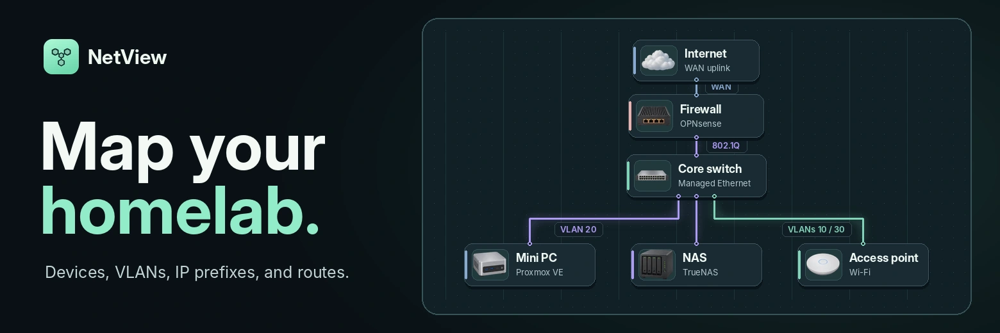
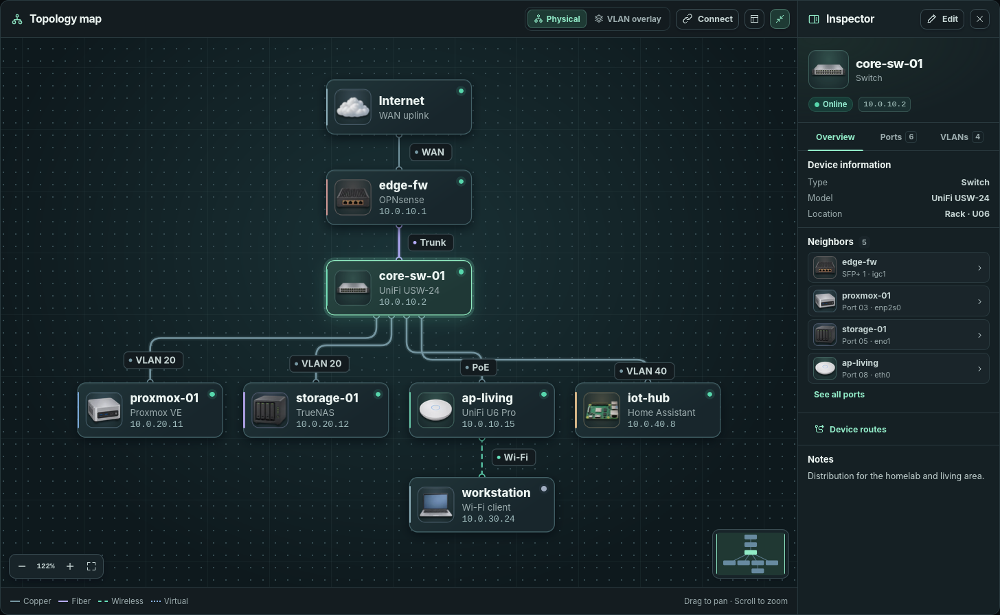
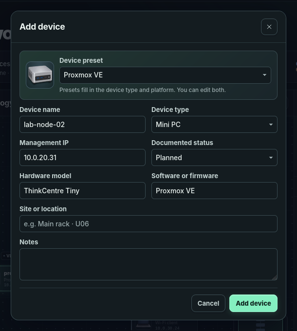
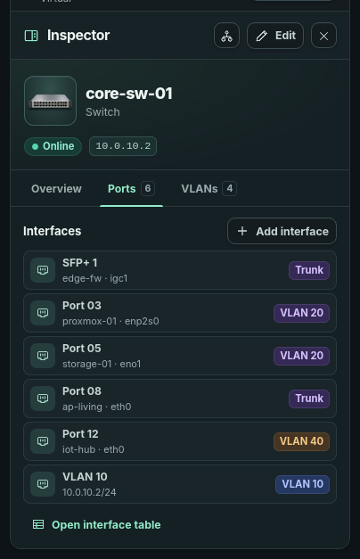
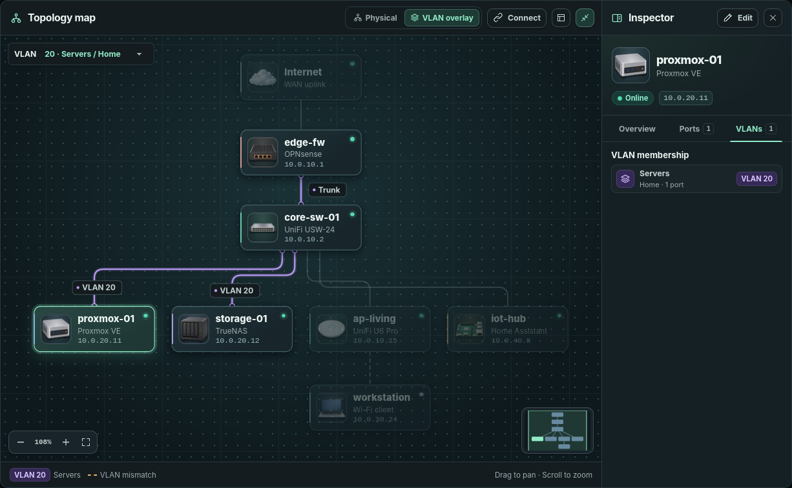
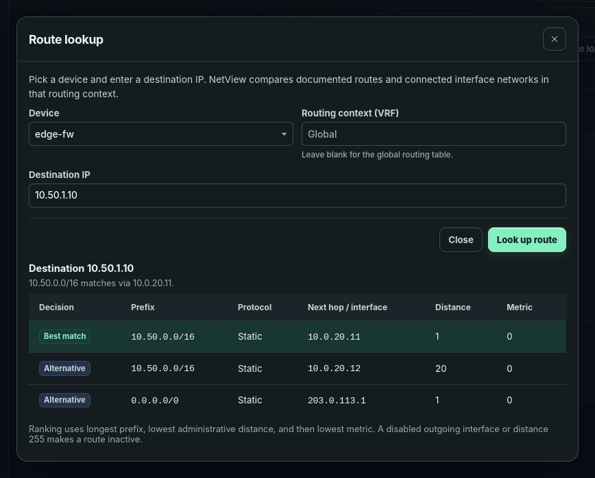

  
  <h1>NetView</h1>
  
<strong>An interactive network topology mapper for homelabs and small networks.</strong>

  
See what’s connected, which VLANs each port carries, and where your routers would send traffic.

**[Topology](#network-topology)** · **[Devices and ports](#devices-and-ports)** · **[VLANs](#vlan-segmentation)** · **[IP planning](#ipv4-and-ipv6-address-planning)** · **[Routing](#routing-tables-and-route-lookup)** · **[Workspace](#your-workspace)**

NetView brings network diagrams, device inventory, cabling, and IP address planning into one dark-mode web app. It runs in your browser on GitHub Pages without an account and builds the map from records you enter or import. You can explore a built-in fictional homelab or start with a blank workspace.

## Network topology

The interactive map shows physical and virtual connections between devices. You can drag devices into place or auto-arrange the whole map, then pan, zoom, or expand the canvas. The inspector shows the exact interfaces at both ends of a connection, along with its medium, speed, and documented status. NetView supports copper Ethernet, fiber, wireless, and virtual links.

## Devices and ports

Your inventory can include everything from a modem and patch panel to a mini PC, NAS, VM, container, or self-hosted service. A device record can hold its hardware model, software or firmware, management IP, location, notes, and manually recorded status. Presets prefill editable details for platforms such as OPNsense, pfSense CE, OpenWrt, Proxmox VE, TrueNAS, Home Assistant, and Pi-hole.

The port inspector shows what’s connected to each interface and which VLANs and IP addresses are assigned to it. Workspace search covers devices, interfaces, connections, VLANs, prefixes, and routes.

| Proxmox VE device preset | Mobile switch port inspector |
| --- | --- |
|  |  |

## VLAN segmentation

NetView documents 802.1Q VLANs down to individual ports, including access ports, tagged trunks, native or untagged VLANs, and virtual interfaces. VLAN domains let you reuse the same VLAN ID in separate networks. The VLAN overlay highlights where a segment appears on the map and flags mismatched assignments between documented link endpoints.

In the demo, the overlay shows **Servers VLAN 20** between the firewall, core switch, Proxmox host, and TrueNAS storage.

## IPv4 and IPv6 address planning

The **IP Prefixes** inventory tracks named IPv4 and IPv6 subnets in CIDR notation, along with their gateways, VLANs, and routing contexts (VRFs). You can record multiple addresses on a dual-stack interface and document which ranges belong to management, servers, IoT, or guests.

## Routing tables and route lookup

You can document routes per device and VRF, including destination prefixes, next hops, outgoing interfaces, administrative distance, and metric. **Route lookup** compares an IPv4 or IPv6 destination against the recorded routes and directly connected networks for the selected device. It ranks eligible routes by longest prefix, then lowest administrative distance and metric, and shows alternatives, ties, and inactive matches.

In the demo, a lookup for `10.50.1.10` on the edge firewall favors `10.50.0.0/16` via `10.0.20.11` over the backup and default routes. The result reflects the data in your workspace.

## Your workspace

Your edits are saved automatically in the current browser profile for the app’s URL. A complete workspace can be exported as JSON for backup or imported into another browser. Importing replaces the current workspace, and clearing the site’s browser data removes the local copy.
